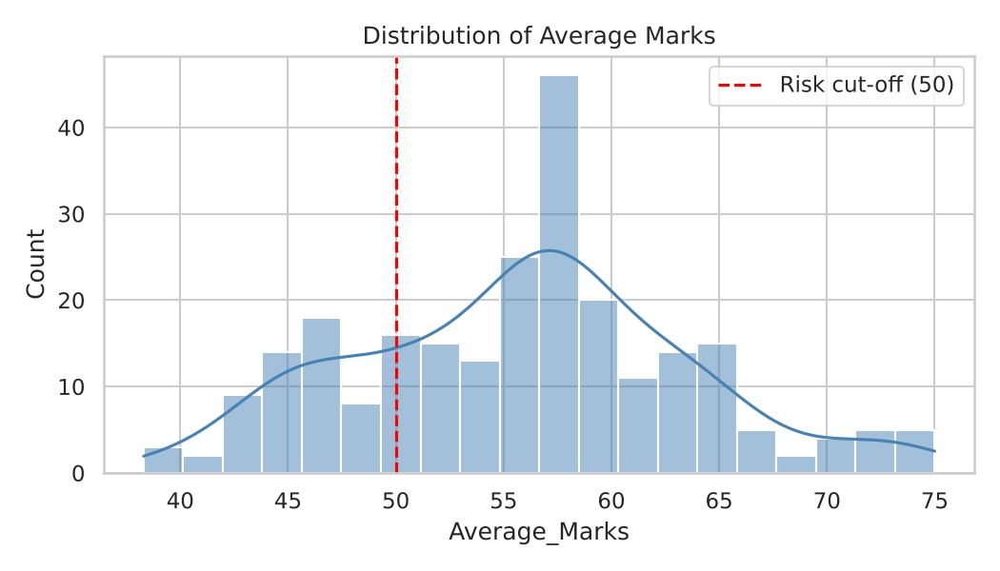
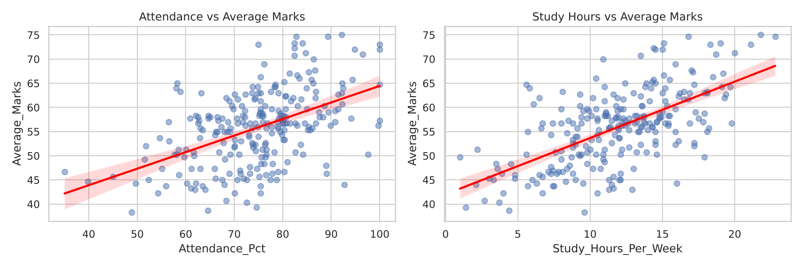
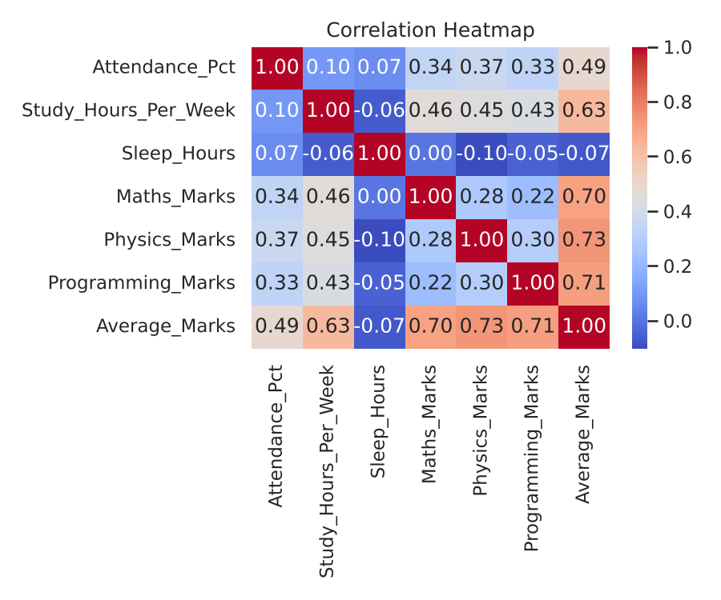
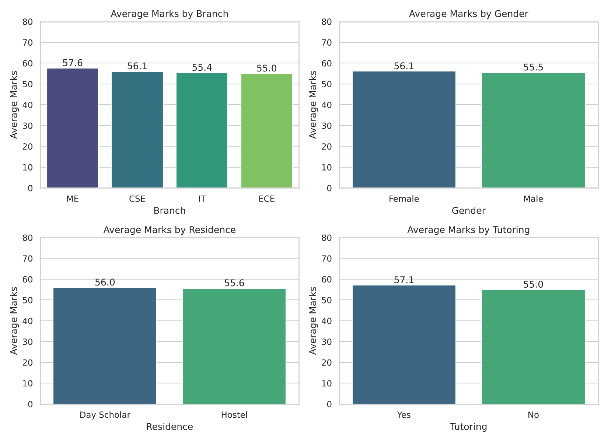
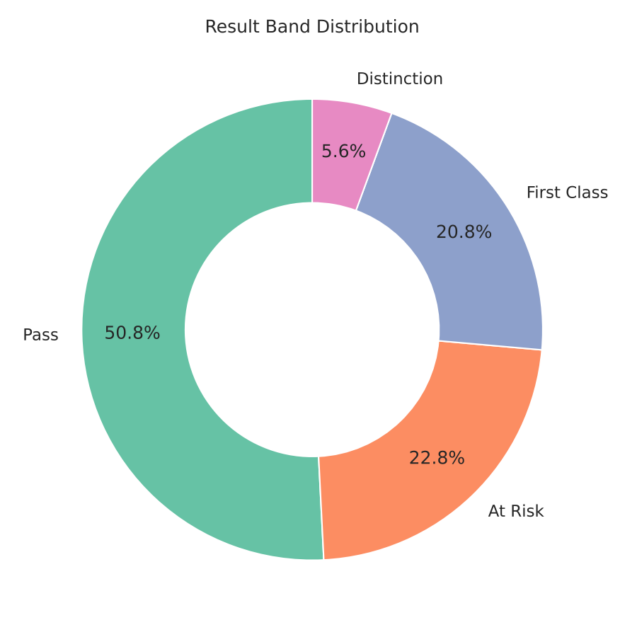

# Student Performance Analysis

Analysis of first-semester student performance using Python, pandas, NumPy, matplotlib and seaborn.

## Problem
The college wants to understand what drives first-semester marks so mentors can support at-risk students early.

Questions answered:
1. What is the overall performance of the batch?
2. Do attendance and study hours affect marks?
3. Does performance differ by branch, gender, residence or tutoring support?
4. Which students are at risk (average marks below 50)?

## Dataset
Synthetic (computer-generated) data with 255 rows and 11 columns. It contains **no real student data**. It deliberately includes missing values, duplicate rows, inconsistent text (for example `yes`, `male`, ` cse `) and one impossible value (marks above 100) for data-cleaning practice.

| Column | Description |
|---|---|
| Student_ID | Unique student code (S1001, S1002, ...) |
| Gender, Branch, Residence | Student profile (Male/Female; CSE/IT/ECE/ME; Hostel/Day Scholar) |
| Attendance_Pct | Attendance percentage |
| Study_Hours_Per_Week | Self-study hours in a week |
| Sleep_Hours | Average hours of sleep per day |
| Tutoring | Whether the student takes extra tutoring |
| Maths_Marks, Physics_Marks, Programming_Marks | Semester marks out of 100 |

## Steps
1. Load and inspect the data
2. Clean: drop duplicates, standardise text, fix marks above 100, fill missing numbers with the median
3. Create `Average_Marks`, `Total_Marks`, `Result_Band`, `Attendance_Group`, `At_Risk`
4. Explore and visualise
5. Insights and recommendations

## Key findings
Based on the generated dataset (seed 42):
- Mean average marks are about 55.8; result bands: Pass 127, First Class 52, Distinction 14 (average 70+), At Risk 57 (22.8%).
- Study hours (r ≈ 0.63) and attendance (r ≈ 0.49) show a moderate positive relationship with average marks. Correlation is association, not cause.
- At-risk rate falls sharply as attendance rises: about 55% for attendance below 60%, 28% for 60-75%, 14% above 75%.
- Tutoring students score about 2 marks higher on average; differences by branch, gender and residence are small.
- Sleep hours show almost no relationship with marks (r ≈ -0.07).

## Charts






## Project structure
```
student-performance-analysis/
|-- data/
|   |-- raw/student_performance.csv
|   `-- processed/student_performance_clean.csv
|-- notebooks/student_performance_analysis.ipynb
|-- images/
|-- scripts/generate_data.py
|-- requirements.txt
|-- .gitignore
`-- README.md
```

## How to run
```bash
pip install -r requirements.txt
python scripts/generate_data.py      # optional: regenerates the raw data
jupyter notebook notebooks/student_performance_analysis.ipynb
```

## Author
Himanshu
